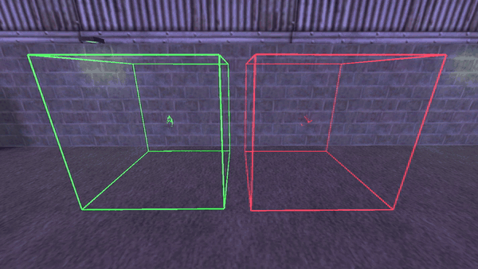

<h1 align="center">Barrier Zone</h1>

<p align="center">
  
</p>

## 📝 Description
This plugin adds fully dynamic barrier zones to Counter-Strike 1.6.
Barrier zones can be placed, managed and configured during gameplay to block off paths, chokepoints, and areas of the map with full runtime control over activation states.
Custom setups are saved per map and automatically loaded on every map start.
- Create and remove barrier zones during gameplay via an in-game menu
- Configurable per zone: activation chance, delay, duration, and cooldown
- Delayed and timed activation with random ranges for round-based gameplay
- Visible radar icon and active/inactive color states for clear player feedback
- Intuitive ghost preview and sizing tools for natural placement along any surface

## 📋 Requirements
- ReGameDLL
- AMX Mod X 1.10+

## 💬 Commands
- `say /barrierzone` - Opens the Barrier Zone menu.
- `say_team /barrierzone` - Opens the Barrier Zone menu.
- `barrierzone_reload` - Reloads the configuration file.

## ⚙️ Configuration
```ini
# [Main Settings]
# SETTING_DEFAULT_MODEL           = Default barrier zone model path
# SETTING_DEFAULT_FLAGS           = Default flags (a - Active Delay, b - Active Duration)
# SETTING_DEFAULT_TEAM            = Default team (0 - None, 1 - Terrorist, 2 - Counter-Terrorist, 3 - Both)
# SETTING_DEFAULT_RADAR           = Default radar visibility (0 - Off, 1 - On)
# SETTING_DEFAULT_ACTIVE_CHANCE   = Default probability the zone activates each round (0.0 - 1.0)
# SETTING_DEFAULT_ACTIVE_DELAY    = Default minimum and maximum delay before the zone goes active (requires flag a)
# SETTING_DEFAULT_ACTIVE_DURATION = Default minimum and maximum active duration (requires flag b)
# SETTING_DEFAULT_ACTIVE_COOLDOWN = Default minimum and maximum cooldown before the zone can reactivate
# SETTING_DEFAULT_ICON_SCALE      = Default radar icon scale
# SETTING_DEFAULT_ICON_ALPHA      = Default radar icon transparency
# SETTING_DEFAULT_ICON_SPRITE     = Default radar icon sprite path
```

## 🔄 Changelog
```text
* v1.0: Initial release.
```

[](https://www.youtube.com/watch?v=RXxDzok3cD0)
